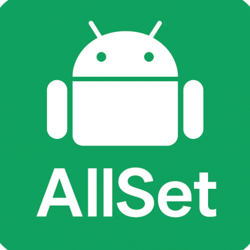
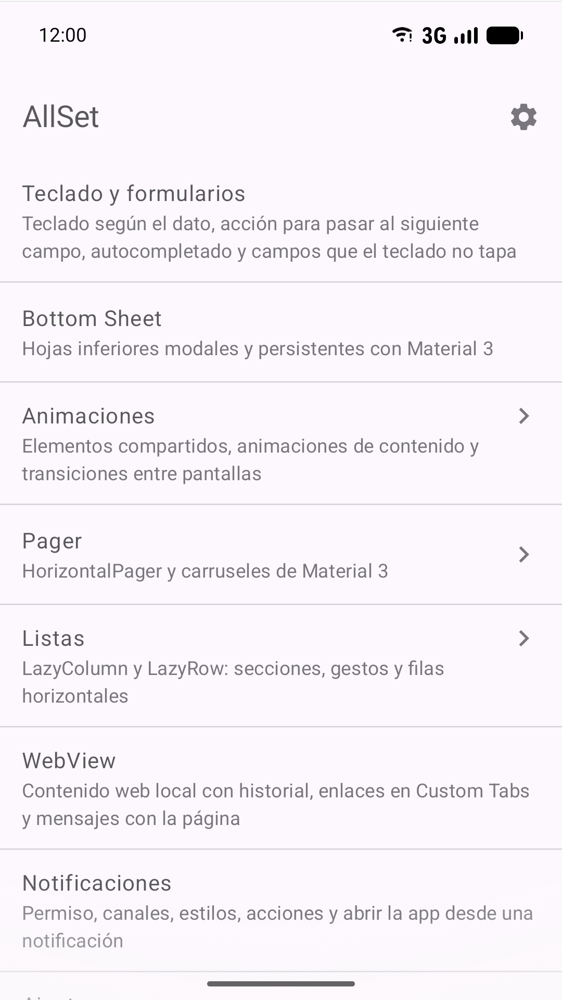
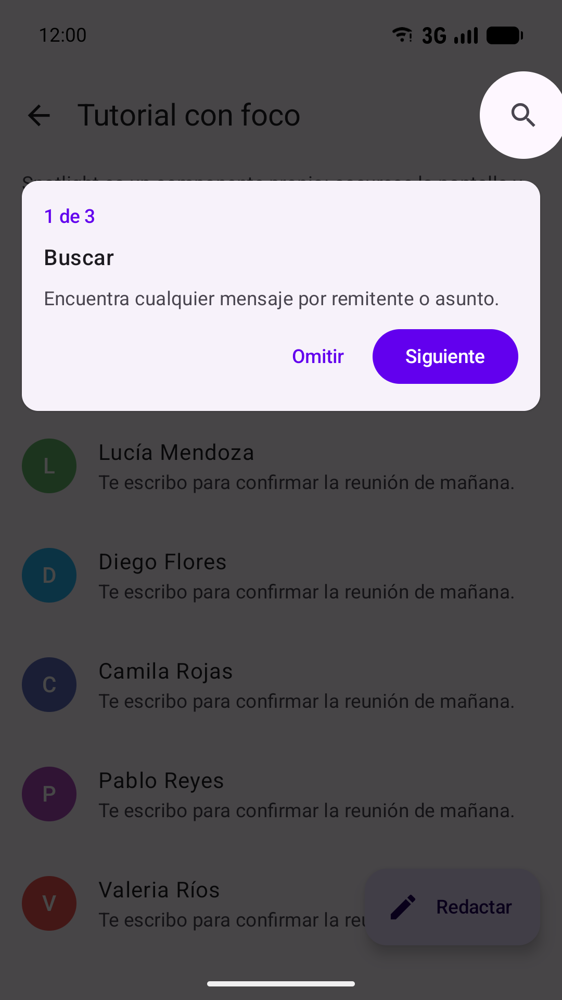
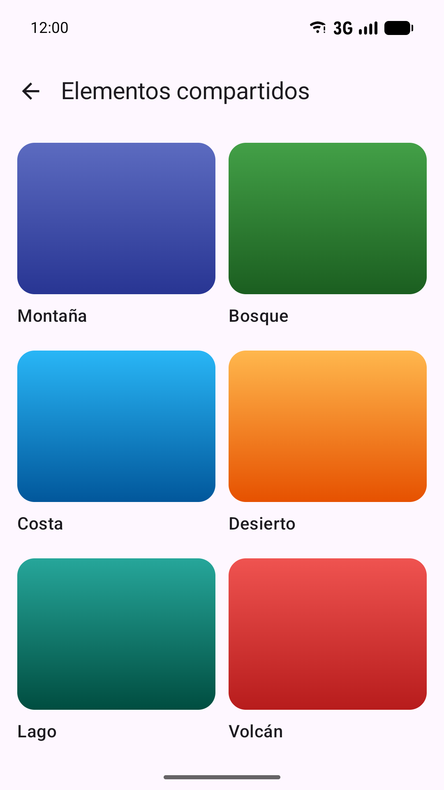
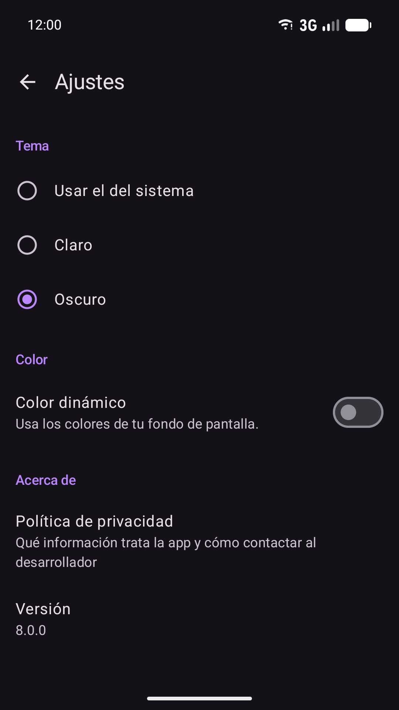

<p align="center">
  
</p>

<h1 align="center">AllSet</h1>

<p align="center">
  Ejemplos prácticos de componentes y APIs de Android hechos con Jetpack Compose y Material 3.
</p>

<p align="center">
  
  
  
  
  
</p>

AllSet es un catálogo de demos para desarrolladores Android. Cada una resuelve un caso real con las APIs actuales de
la plataforma, para probarlo en un teléfono y leer cómo está hecho. Toda la UI está escrita en Compose, sin layouts
XML, y los textos de la app están en español.

<p align="center">
  
  
  
  
</p>

## Demos

| Demo | Qué muestra |
|---|---|
| **Teclado y formularios** | `TextFieldState`, teclado según el dato, acciones IME, autocompletado, campos seguros y `imePadding` |
| **Bottom Sheet** | Hojas inferiores modales y persistentes de Material 3, con confirmación antes de descartar |
| **Animaciones** | Elementos compartidos, `AnimatedContent`, `AnimatedVisibility`, valores animados y transiciones de Navigation 3 con el gesto atrás predictivo |
| **Pager** | Introducción con `HorizontalPager` y carruseles de Material 3 (multi-browse, hero y sin contención) |
| **Listas** | Encabezados fijos, deslizar para marcar o eliminar con deshacer, arrastrar para recargar y `LazyRow` dentro de `LazyColumn` |
| **WebView** | Páginas locales con `WebViewAssetLoader`, mensajes entre la página y la app, Custom Tabs y recuperación si el renderizador se cae |
| **Notificaciones** | Permiso de Android 13, canales, estilos de texto largo, imagen y progreso, acciones y apertura desde la notificación |
| **Ajustes** | Tema claro, oscuro o del sistema y color dinámico guardados con DataStore |
| **Efectos de imagen** | Componentes propios: efecto Ken Burns y zoom con gestos |
| **Tabs** | Pestañas fijas con pager, pestañas desplazables y contadores |
| **Portapapeles** | `LocalClipboard`, contenido sensible y lectura solo al pegar |
| **Tutorial con foco** | Componente propio que oscurece la pantalla y resalta elementos paso a paso |

## Stack

- Kotlin 2.4, AGP 9.4 (con Kotlin integrado) y Gradle 9.8, con un catálogo de versiones en `gradle/libs.versions.toml`.
- Jetpack Compose (BOM 2026.09) con Material 3 y Navigation 3.
- Lifecycle, DataStore Preferences, WebKit y Browser (Custom Tabs).
- `compileSdk 37`, `targetSdk 36` y `minSdk 24`.
- Las dependencias declaradas son solo de AndroidX y Kotlin. No hay inyección de dependencias.

## Cómo ejecutarlo

Requisitos: JDK 17 y una versión de Android Studio compatible con AGP 9.4.

```bash
git clone https://github.com/Hacybeyker/AllSet.git
cd AllSet
./gradlew :app:installDebug
```

Antes de enviar cambios, ejecuta las mismas verificaciones que el proyecto usa en cada commit:

```bash
./gradlew :app:minifyReleaseWithR8 :app:testDebugUnitTest :app:lintDebug
```

El build de release se firma con propiedades que no están en el repositorio. Para compilar en debug no hacen falta.

## Estructura

```
app/src/main/java/com/hacybeyker/allset/
├── MainActivity.kt      Actividad única con edge-to-edge y el tema guardado en Ajustes
├── navigation/          Claves de navegación y NavDisplay
├── core/                Datos (DataStore) y UI compartida: tema, componentes, íconos y Custom Tabs
└── feature/<demo>/      Una carpeta por demo
play-store/              Textos, gráficos y notas de versión de la ficha de Google Play
```

[`AGENTS.md`](AGENTS.md) reúne las reglas y convenciones del proyecto para quien colabore, sea persona o IA.

## Privacidad

AllSet no recopila ni comparte datos, no tiene anuncios ni analítica y no se conecta a internet. Consulta la
[política de privacidad](https://hacybeyker.github.io/allset/privacidad/).

## Licencia

```
Copyright 2022-2026 Carlos Osorio

Licensed under the Apache License, Version 2.0 (the "License");
you may not use this file except in compliance with the License.
You may obtain a copy of the License at

    http://www.apache.org/licenses/LICENSE-2.0

Unless required by applicable law or agreed to in writing, software
distributed under the License is distributed on an "AS IS" BASIS,
WITHOUT WARRANTIES OR CONDITIONS OF ANY KIND, either express or implied.
See the License for the specific language governing permissions and
limitations under the License.
```

El robot de Android se reproduce o modifica a partir del trabajo generado y compartido por Google, y se usa conforme a
lo descrito en la [Licencia de Atribución de Creative Commons 3.0](https://creativecommons.org/licenses/by/3.0/).
